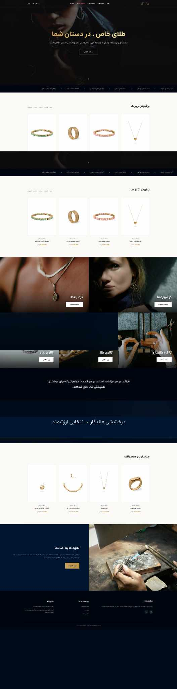

# Velza Gallery

**Gold & Jewelry Retail Website · Client Project Portfolio Case Study**

## Overview

Persian RTL website for a gold and jewelry gallery, with a dark navy-and-gold visual identity, an editorial homepage, featured and new product sections, jewelry categories, collection banners, and brand storytelling.

## My Contribution

- Jewelry retail website implementation and presentation
- Product/category and collection structure
- Persian RTL interface and content hierarchy
- Homepage sections, product cards, and editorial banners

## Technologies / Focus

- Persian RTL Interface
- Jewelry Product Presentation
- Product and Collection Discovery
- Visual Design
- E-Commerce Website Layout

## Source Code

The production source code is **not published** in this repository. This is a client-owned project, and this repository is intentionally limited to a portfolio case study and archived visual material.

## Portfolio Note

The screenshot above is an archived project preview from my portfolio records. A client's live website may have changed after delivery, so the current production site should not automatically be treated as an exact representation of the version shown here.

## Rights & Attribution

Client names, trademarks, logos, product photography, and other third-party visual assets remain the property of their respective owners. This repository documents my professional contribution and does not redistribute the underlying client codebase.
